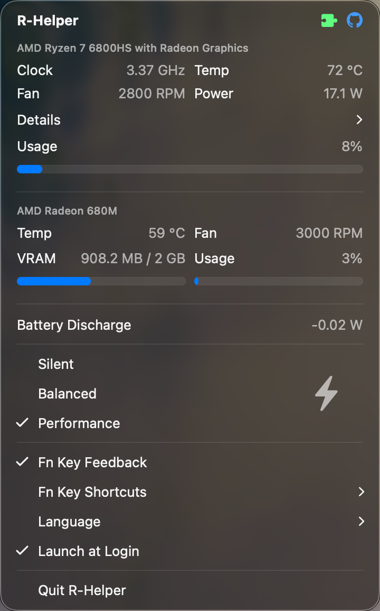
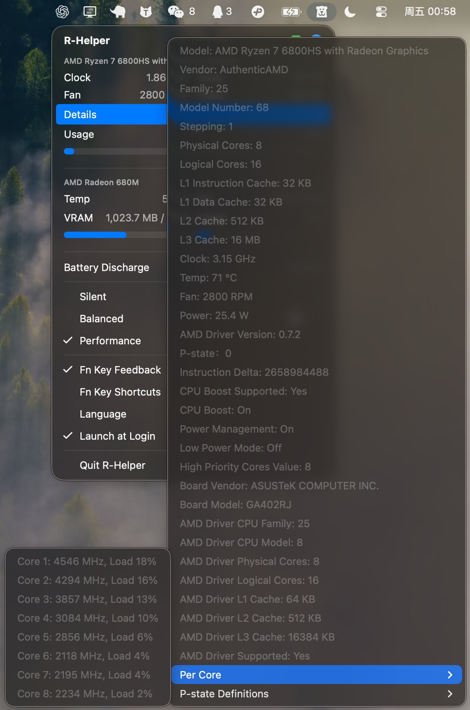
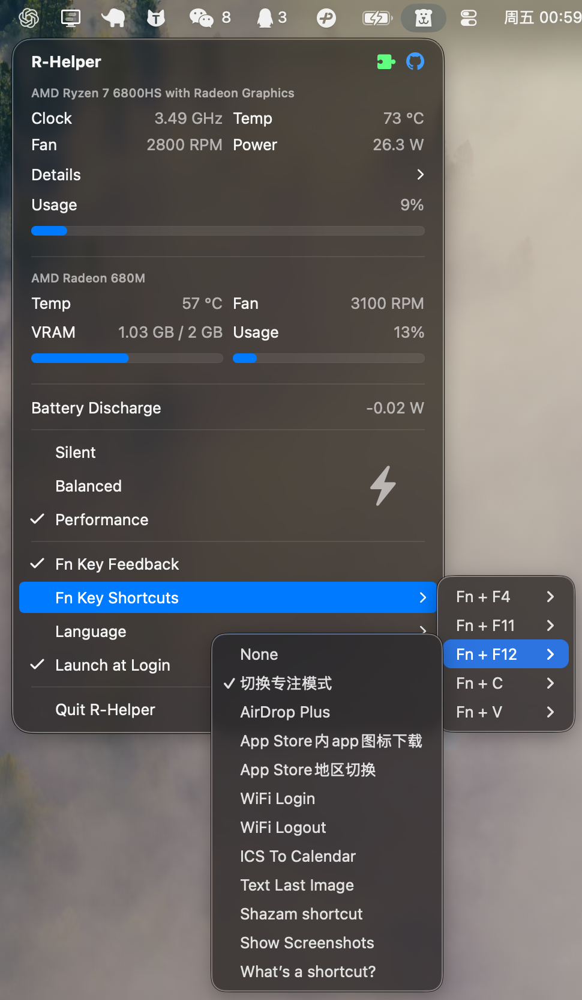
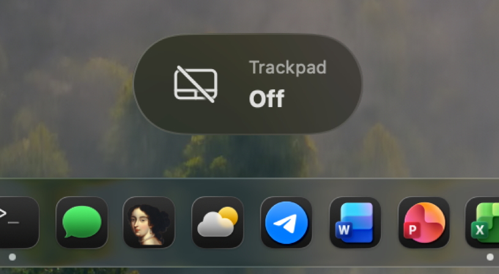
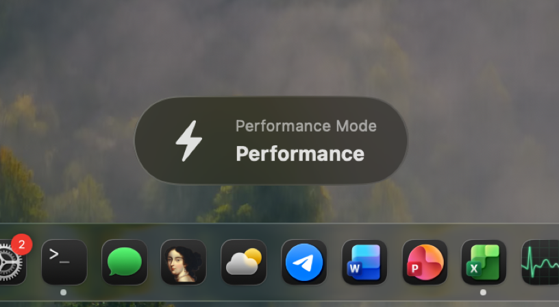
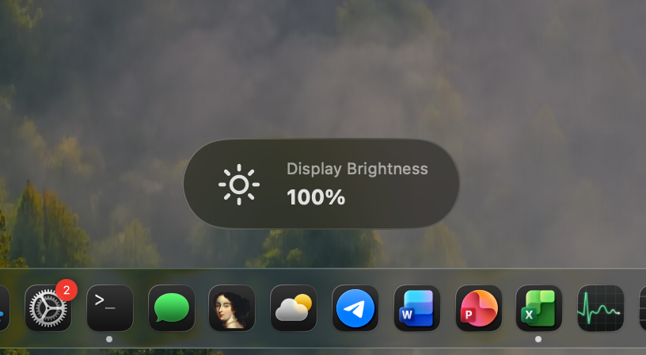

# R-Helper

English | [简体中文](README_zh-CN.md)

R-Helper is a macOS menu bar app for ASUS Hackintosh laptops. It provides performance mode controls, Fn key feedback, and hardware monitoring.

## Features

- Switch between Silent, Balanced, and Performance modes.
- Display available CPU, GPU, VRAM, fan, and battery readings.
- Show feedback for supported Fn keys and bind them to existing Shortcuts.
- Launch at login and use the app in English or Simplified Chinese.

Available hardware features and readings depend on the model, firmware, and installed drivers.

## Requirements

- **[AsusACPIService.kext](https://github.com/SaKongA/AsusACPIService)**: Provides ASUS ACPI controls and readings such as fan and battery data. Install and load the driver for this project, and ensure the device's ACPI configuration can be recognized by the driver.
- **[AMDRyzenCPUPowerManagement.kext](https://github.com/trulyspinach/SMCAMDProcessor)** (optional): Provides frequency, temperature, power, and detailed information for supported AMD Ryzen CPUs.
- **[VoodooI2C](https://github.com/VoodooI2C/VoodooI2C) and its trackpad driver** (optional): Enable reading and toggling the trackpad state when using a compatible VoodooI2C trackpad service.

Features or readings that depend on optional drivers may be unavailable when those drivers are not installed. The current minimum supported version is macOS 26.5.

## Build

The app requires protocol headers from the driver repository. Place the two repositories in the same parent directory:

```text
R-Helper/
├── R-Helper/
└── AsusACPIService/
```

Open `R-Helper/R-Helper.xcodeproj` in Xcode, select My Mac, and build or archive the app.

## Screenshots












