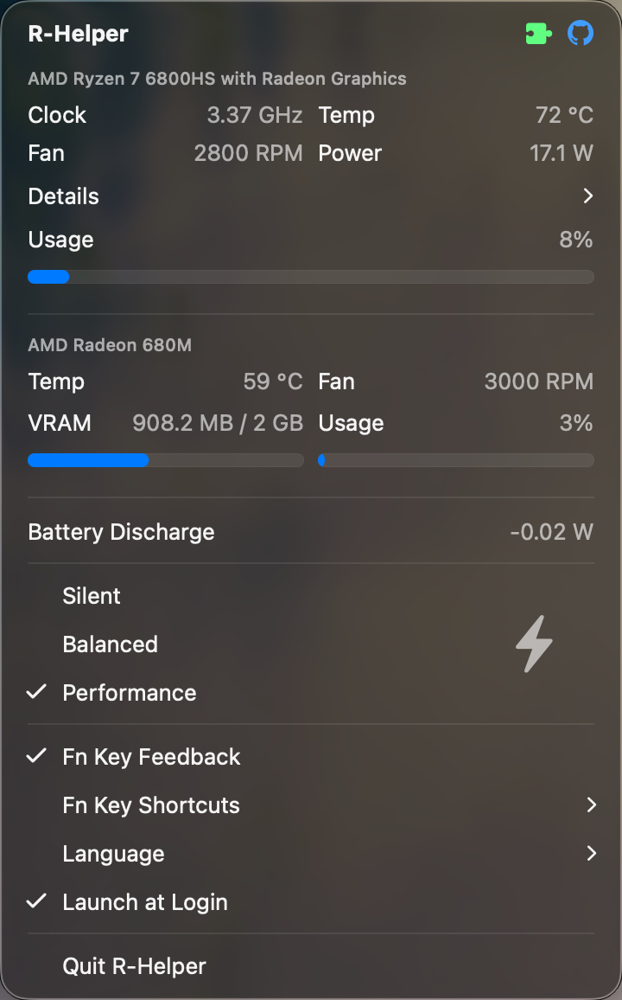
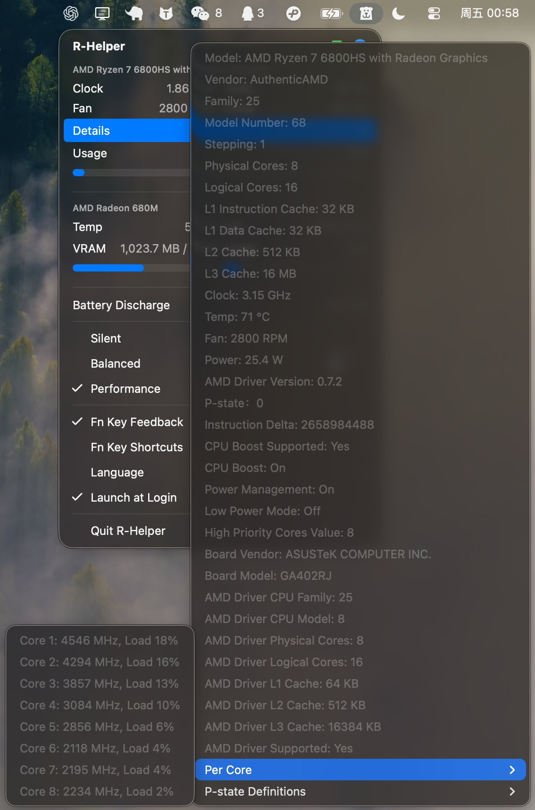
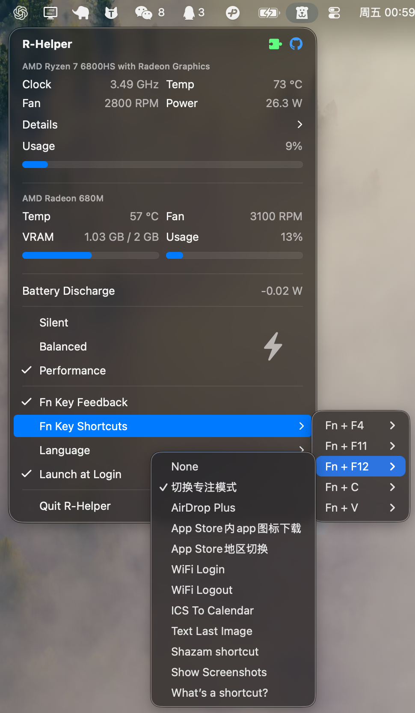
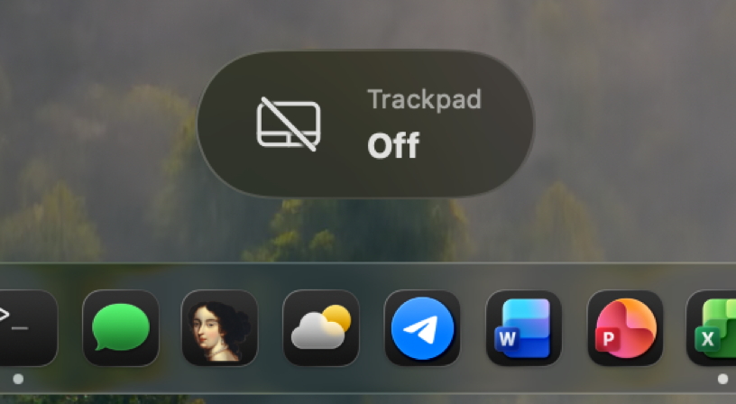
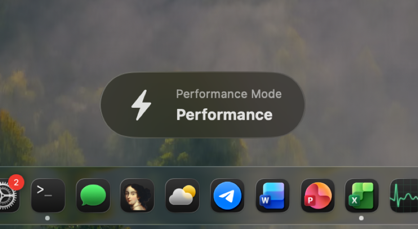
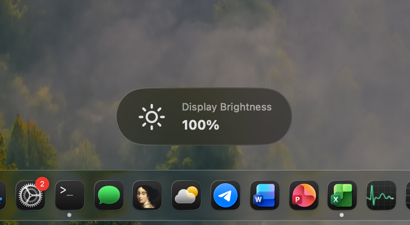

# R-Helper

[English](README.md) | 简体中文

R-Helper 是华硕笔记本黑苹果的 macOS 菜单栏工具，提供性能模式切换、Fn 快捷键提示和硬件状态监控。

## 功能

- 切换静音、平衡和性能模式
- 显示 CPU、GPU、显存、风扇和电池的可用数据
- 响应支持的 Fn 快捷键，显示操作提示，并可绑定已有快捷指令
- 支持登录时启动和中英文界面

硬件功能和可读取的数据取决于机型、固件及已安装的驱动。

## 前置依赖

- **[AsusACPIService.kext](https://github.com/SaKongA/AsusACPIService)**：提供华硕 ACPI 控制、风扇及电池等数据。需要安装并加载本项目配套的驱动，并确保设备的 ACPI 配置可供驱动识别。
- **[AMDRyzenCPUPowerManagement.kext](https://github.com/trulyspinach/SMCAMDProcessor)**：可选，用于读取受支持的 AMD Ryzen CPU 频率、温度、功耗和详细信息。
- **[VoodooI2C](https://github.com/VoodooI2C/VoodooI2C) 及其触控板驱动**：可选，使用兼容的 VoodooI2C 触控板服务时，支持读取和切换触控板状态。

未安装可选驱动时，对应功能或数据可能不可用。当前项目的最低系统版本为 macOS 26.5。

## 构建

App 构建时需要引用驱动仓库中的协议头文件。请将两个仓库放在同一个父目录下：

```text
R-Helper/
├── R-Helper/
└── AsusACPIService/
```

使用 Xcode 打开 `R-Helper/R-Helper.xcodeproj`，选择 My Mac 后构建或归档。

## 截图












